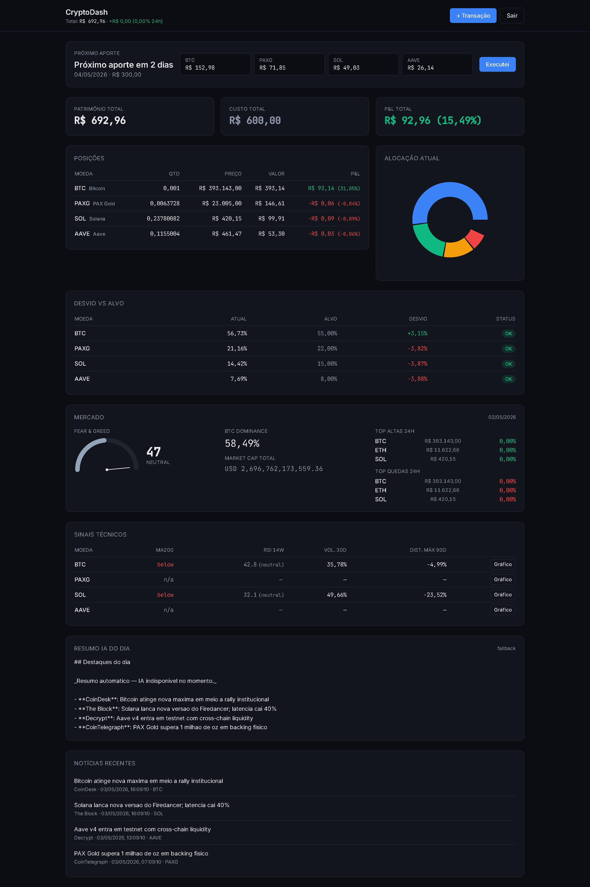

# CryptoDash

Dashboard pessoal de portfolio de criptomoedas. Reúne em uma única tela: estado do portfolio, contexto de mercado, sinais técnicos objetivos e resumo de notícias gerado por IA.

> Single-user, projeto pessoal/portfólio. Não executa ordens. Não armazena chaves de exchange. Não dá conselho de investimento.

## Stack

- **Backend:** .NET 8 Web API · EF Core 8 · PostgreSQL 16 · Quartz.NET · Refit · Serilog · BCrypt + JWT
- **Frontend:** React 18 · TypeScript · Vite 6 · Tailwind 3 · TanStack Query 5 · Zustand · Recharts
- **Integrações:** CoinGecko, Alternative.me (Fear & Greed), CryptoPanic, Anthropic Claude
- **Deploy:** Docker Compose · Nginx + Let's Encrypt · backup `pg_dump` automático

## Arquitetura (Clean Architecture)

```
CryptoDash.sln
├── src/
│   ├── CryptoDash.Domain/          (entidades, enums)
│   ├── CryptoDash.Application/     (DTOs, services, abstrações)
│   ├── CryptoDash.Infrastructure/  (EF Core, Refit, Quartz jobs)
│   └── CryptoDash.Api/             (controllers, JWT, Program.cs)
└── frontend/                       (React + Vite + Tailwind)
```

Regras: `Api → Application → Domain`, `Infrastructure → Application + Domain`. Domain não depende de nada.

## Funcionalidades

| Sprint | Entregue |
|---|---|
| **1 — Foundation** | Auth JWT, CRUD de transações manuais, holdings recalculadas (avg cost), preços ao vivo via CoinGecko (Quartz a cada 15 min), dashboard com Holdings + Allocation Donut + Deviation Table |
| **2 — Market** | OHLCV diário (retenção 2 anos), Fear & Greed, BTC dominance, MA200, RSI semanal Wilder, volatilidade anualizada 30d, distância de máximas 90d/365d, gráfico histórico modal 30/90/1y |
| **3 — DCA + IA** | Plano de aporte mensal, algoritmo greedy proporcional ao gap, sugestão de distribuição, fluxo "executei → cria transactions", news cache CryptoPanic, digest IA diário (Claude com fallback determinístico) |
| **4 — Polish** | PWA manifest + service worker, Dockerfile multi-stage, Nginx reverse proxy + HTTPS, backup pg_dump diário com retenção 7 dias |

## 📖 Manual com prints

Veja o **[Manual de uso](docs/MANUAL.md)** com screenshots de todas as telas, fluxos e modais. Útil pra entender o produto sem precisar rodar.

[](docs/MANUAL.md)

## Setup local

```bash
# pré-requisitos: docker 24+, dotnet 8 SDK, node 20 LTS
cp .env.example .env
docker compose up -d
# api: http://localhost:5000   frontend: http://localhost:5173
```

Login seedado: `gustavo@cryptodash.local` / `ChangeMe@123` (ou o que estiver em `.env`).

## Deploy produção

```bash
cp .env.production.example .env.production
# editar .env.production com secrets reais
docker compose --env-file .env.production -f docker-compose.prod.yml up -d --build
```

Antes de subir, gere certificados Let's Encrypt em `deploy/letsencrypt/live/<seu-domínio>/` (use `certbot` no host) e ajuste `server_name` em `deploy/nginx/nginx.conf`.

## Endpoints principais

```
POST /api/v1/auth/login
GET  /api/v1/portfolio/summary
GET  /api/v1/portfolio/holdings
POST /api/v1/portfolio/transactions
GET  /api/v1/portfolio/rebalance-suggestion
GET  /api/v1/market/overview
GET  /api/v1/market/coins/{symbol}/history?range=30d|90d|1y
GET  /api/v1/market/coins/{symbol}/indicators
GET  /api/v1/aports/next
POST /api/v1/aports/execute
GET  /api/v1/news/digest/today
```

## Jobs Quartz

| Job | Cron | Descrição |
|---|---|---|
| `PriceSnapshotJob` | a cada 15 min | preços CoinGecko |
| `PriceHistoryJob` | 1h da manhã | OHLCV diário (retenção 2 anos) |
| `MarketIndicatorsJob` | 2h | Fear & Greed + BTC dominance |
| `NewsFetchJob` | a cada 2h | CryptoPanic |
| `AIDigestJob` | 7h | digest Claude (idempotente) |
| `AportReminderJob` | 9h | log se hoje é dia de aporte |

## Segurança

- Secrets em variáveis de ambiente; `.env` e `.env.production` no `.gitignore`.
  Os arquivos `.env*.example` **são** versionados e contêm apenas placeholders — troque todos antes de subir.
- `backups/` e `deploy/letsencrypt/` também ignorados: dumps do banco e chave privada TLS.
- JWT key mínimo 32 chars (`openssl rand -hex 32`).
- BCrypt work factor 12 para senhas.
- HTTPS obrigatório em produção (Let's Encrypt).
- CORS restrito ao domínio público.
- Sem PII além de email do user.

## Limitações conhecidas

- P&L é estimado: preços CoinGecko podem divergir do que o Itaú íon executou.
- Sem backtest, sem alertas, sem multi-user (escopo v1).
- Custo Claude limitado a 1 digest/dia (~centavos/mês).

## Licença

Projeto pessoal / portfólio. Use à vontade como referência.
