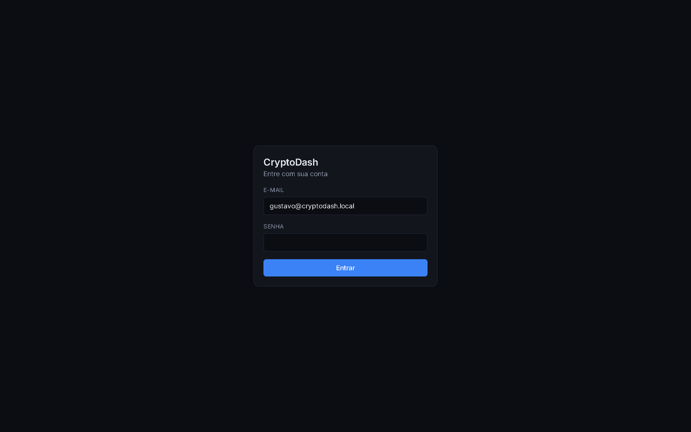
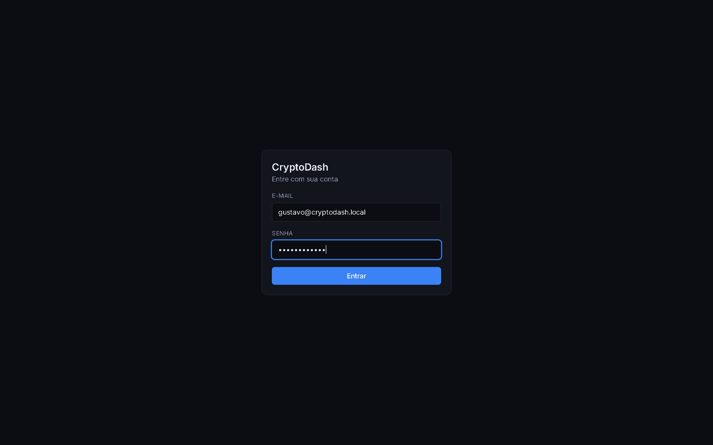
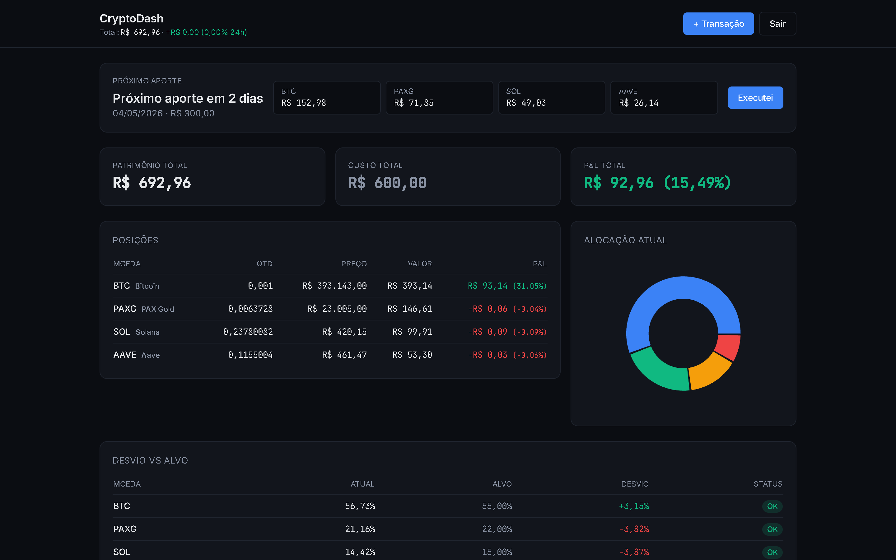
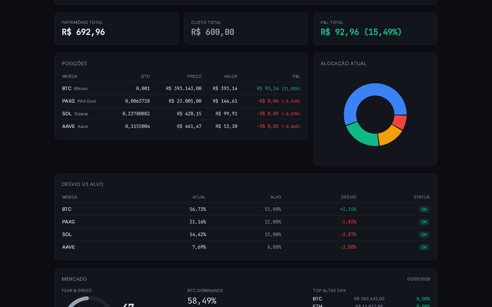
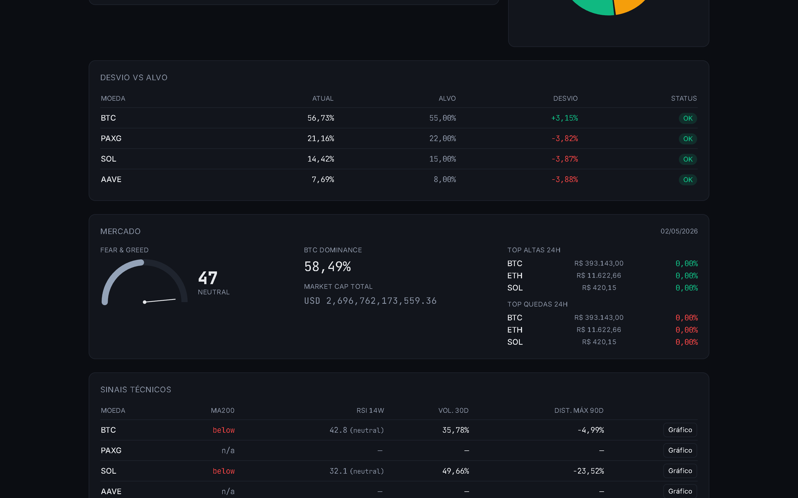
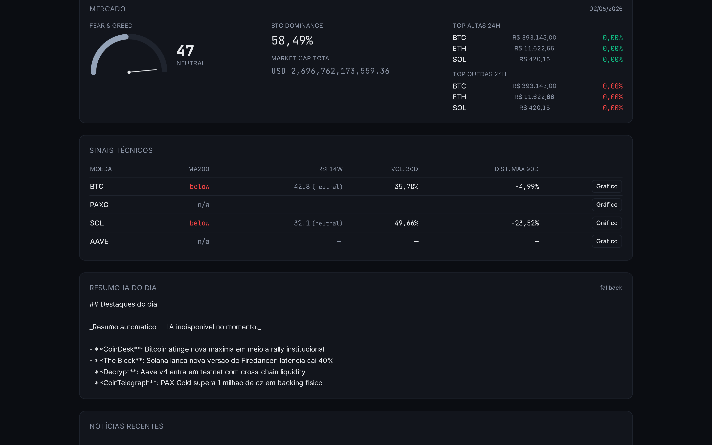
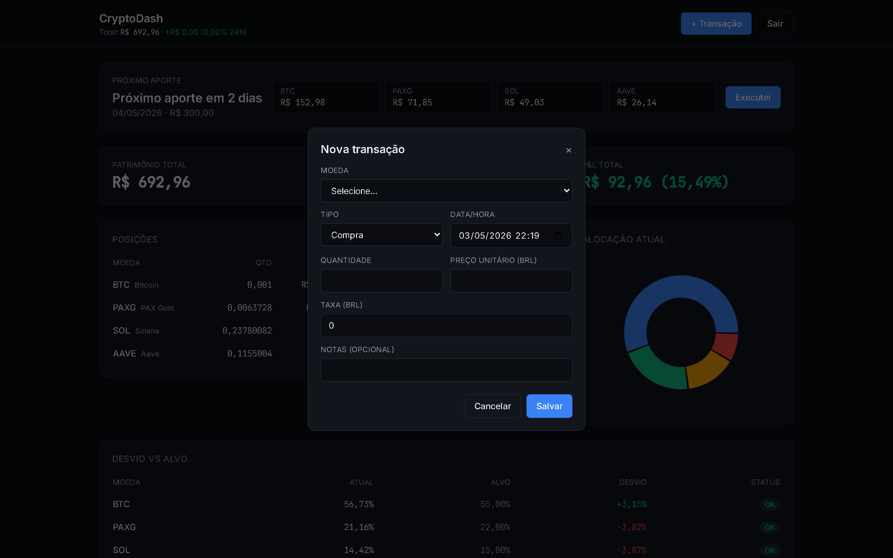
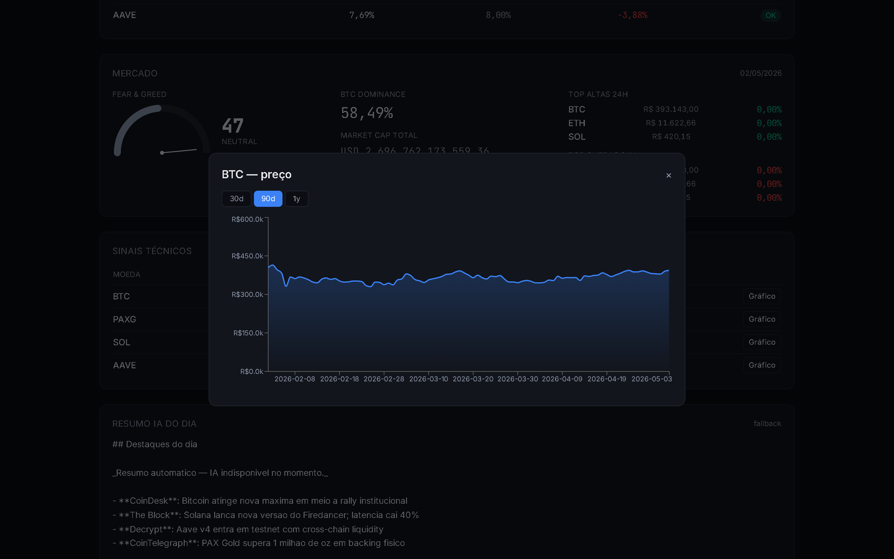
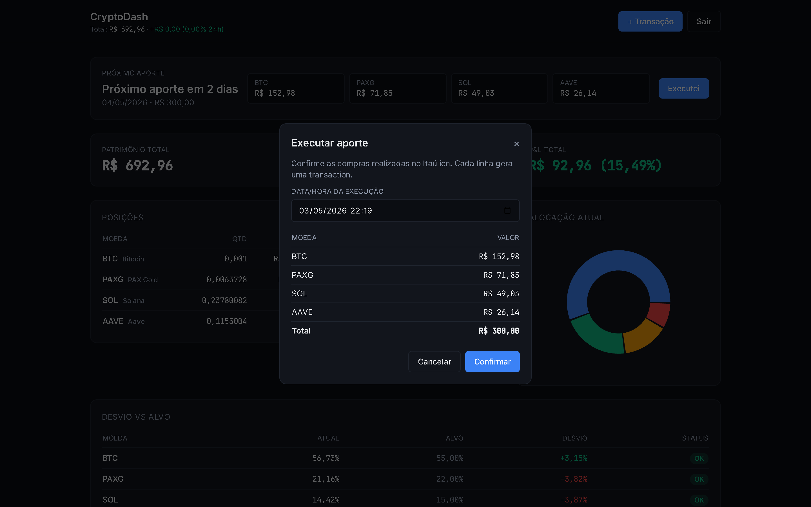

# CryptoDash — Manual de uso

> Guia visual de cada tela do dashboard. Versão 1.0 (Sprint 1–4 do PRD).

Antes de começar:

```bash
# 1. clone
git clone <url>
cd CriptoDash

# 2. dev local (Docker Compose recomendado)
cp .env.example .env
docker compose up -d
# api → http://localhost:5000   |   frontend → http://localhost:5173

# 2b. ou rode separado (sem Docker)
#    backend (SQLite em dev): cd src/CryptoDash.Api && dotnet run
#    frontend:                cd frontend && npm run dev
```

Login seedado: `gustavo@cryptodash.local` / `ChangeMe@123` (sobrescrito por `Seed:UserEmail`/`Seed:UserPassword` no `.env`).

---

## 1. Login

Tela inicial. JWT Bearer com BCrypt (work factor 12). E-mail vem pré-preenchido com o seed para acelerar testes locais — em produção, deixe vazio.



Ao preencher e clicar em **Entrar**, o token é guardado em `localStorage` (chave `cryptodash.auth`) e a navegação vai para `/portfolio`. O `AuthGuard` redireciona qualquer rota protegida para `/login` se o JWT estiver expirado.



---

## 2. Dashboard — visão completa

Página única (single-page dashboard) responsiva, mobile-first. Todas as seções são carregadas em paralelo via TanStack Query com refetch automático a cada 60s para o portfolio e 5min para o mercado.


A ordem dos blocos segue a hierarquia recomendada pelo PRD: header → próximo aporte → stats → posições/alocação → desvio → mercado → sinais → digest IA → notícias.

---

## 3. Header e Próximo aporte

Header com total do portfolio em destaque e variação 24h colorida (verde se positiva, vermelha se negativa). À direita, **+ Transação** abre o modal de registro manual e **Sair** desloga.

O **Card de próximo aporte** mostra:

- Quantos dias faltam (ou se é hoje, ou se está atrasado — borda muda de cor: cinza, azul, vermelho).
- Distribuição sugerida pela engine DCA: cada moeda recebe um valor calculado pelo algoritmo *greedy* proporcional ao gap (seção 6.3 do PRD).
- Botão **Executei** abre o modal de execução.



> **Como o DCA decide:** se a soma dos gaps até o alvo cobre o aporte, distribui proporcional ao gap. Se sobra, paga os gaps e o resto vai proporcional ao target. Moedas que ficariam abaixo de R$ 5 são redistribuídas para a maior alocação. O ajuste de centavos final cai sempre no maior valor.

---

## 4. Stats principais e Holdings

Três cards: **Patrimônio total** (qty × preço atual CoinGecko), **Custo total** (sum quantity × avg cost) e **P&L total** colorido pela direção. Logo abaixo, a tabela de **Posições** com qty, preço atual, valor em BRL e P&L individual, e o **Donut de alocação** (Recharts) com cores rotativas.



> Números em `tabular-nums` + JetBrains Mono para evitar pulinhos a cada refetch.

---

## 5. Desvio vs alvo e Mercado

A tabela de **Desvio vs alvo** classifica cada moeda com semáforo:

- 🟢 **OK** — desvio relativo abaixo de 10%
- 🟡 **Monitorar** — entre 10% e 25%
- 🔴 **Rebalancear** — acima de 25%

O **Card de mercado** combina:

- Fear & Greed (gauge SVG custom, sem libs externas) com label "Extreme Fear"/"Greed"/etc — fonte: Alternative.me, atualizado 1×/dia pelo `MarketIndicatorsJob`.
- BTC dominance + market cap total (CoinGecko `/global`).
- Top altas e top quedas das últimas 24h (top 3 cada, baseado nos snapshots locais).



---

## 6. Sinais técnicos, Resumo IA e Notícias

A tabela **Sinais técnicos** roda 1 query por moeda em paralelo (TanStack `useQueries`), com cache de 5min:

- **MA200** — média móvel dos últimos 200 closes diários. `above` em verde se preço atual > MA200; `below` em vermelho caso contrário; `n/a` se não houver 200 dias de histórico.
- **RSI 14W** — Wilder smoothing sobre os últimos closes semanais. `oversold` < 30 (verde, oportunidade), `overbought` > 70 (vermelho, cuidado), `neutral` no meio.
- **Vol. 30D** — volatilidade anualizada dos retornos diários (stddev × √365).
- **Dist. máx 90D** — distância percentual do close atual em relação à máxima dos últimos 90 dias.

O botão **Gráfico** em cada linha abre o modal histórico.

O **Resumo IA do dia** é gerado pelo `AIDigestJob` toda manhã às 7h:

- Pega as 15 notícias mais recentes do CryptoPanic (últimas 24h).
- Manda para Claude Sonnet 4.5 com prompt anti-conselho ("não especule, não promova, use bullets").
- Salva o markdown em `ai_digests` com tokens consumidos.
- Fallback determinístico se a Anthropic API falhar — badge "fallback" no card.

A **Lista de notícias** mostra as 15 mais recentes, com link externo para a fonte original.



---

## 7. Modal — Nova transação

Acessível pelo botão **+ Transação** no header. Cria uma compra ou venda manual.



Campos:

- **Moeda** — dropdown com as 11 moedas seedadas (BTC, ETH, SOL, AAVE, PAXG, USDC, LINK, AVAX, LTC, MATIC, XRP).
- **Tipo** — Compra ou Venda.
- **Data/hora** — momento real da execução no Itaú íon (não a hora do registro).
- **Quantidade** — alta precisão (10 casas decimais).
- **Preço unitário (BRL)** — preço médio executado pelo broker.
- **Taxa (BRL)** — opcional, default 0 (Itaú íon não cobra na compra).
- **Notas** — texto livre.

Ao salvar, o serviço:

1. Insere a transaction.
2. Recalcula a holding agregando todas as transactions ordenadas por `executedAt` (FIFO de compras com avg cost; vendas reduzem qty proporcionalmente).
3. Invalida o cache do TanStack — o donut, holdings, P&L atualizam automaticamente.

---

## 8. Modal — Gráfico de preço

Acessível pelo botão **Gráfico** em cada linha da tabela de sinais técnicos.



- Tabs **30d / 90d / 1y** trocam o range OHLCV (cache local em `price_history`, populado pelo `PriceHistoryJob` cron 1h da manhã).
- AreaChart Recharts com gradiente azul, eixo Y em milhares de reais, tooltip com close formatado em BRL.
- Se o histórico ainda não foi populado, mostra "Sem histórico — aguarde o job rodar."

---

## 9. Modal — Executar aporte

Acessível pelo botão **Executei** no card de próximo aporte. Confirma as compras feitas no Itaú íon e gera as transactions correspondentes.



Campos:

- **Data/hora da execução** — quando o aporte foi de fato realizado no broker.
- **Tabela de compras** — uma linha por moeda com o valor sugerido pelo DCA (não-editável aqui; ajustes pontuais devem usar o modal de transação manual).
- **Total** — soma da distribuição.

Ao confirmar, para cada linha com valor > 0:

- Cria uma `Transaction` do tipo Compra com `quantity = amountBrl / priceSnapshot`.
- Atualiza a holding correspondente (avg cost recalculado).
- Registra um `AportExecuted` apontando para todas as transaction IDs criadas, marcando o aporte do mês como cumprido.

A invalidação do cache atualiza dashboard, donut, desvio e a sugestão do próximo aporte (que já considera as novas posições).

---

## 10. Jobs em segundo plano (Quartz)

Todos rodam dentro do processo da API. Logs vão para Serilog no console. Você pode disparar manualmente em dev via:

```bash
TOKEN=$(curl -s -X POST http://localhost:5000/api/v1/auth/login \
  -H "Content-Type: application/json" \
  -d '{"email":"...","password":"..."}' | jq -r .token)

curl -X POST -H "Authorization: Bearer $TOKEN" \
  http://localhost:5000/api/v1/dev/run-job/PriceSnapshotJob
```

Jobs disponíveis:

| Job | Cron | O que faz |
|---|---|---|
| `PriceSnapshotJob` | a cada 15 min | Atualiza `price_snapshots` (CoinGecko `/simple/price`) |
| `PriceHistoryJob` | 01:00 diário | OHLCV diário (CoinGecko `/coins/{id}/market_chart`), retenção 2 anos rolling |
| `MarketIndicatorsJob` | 02:00 diário | Fear & Greed (Alternative.me) + BTC dominance (CoinGecko `/global`) |
| `NewsFetchJob` | a cada 2h | CryptoPanic (requer `CryptoPanic:ApiKey`) |
| `AIDigestJob` | 07:00 diário | Gera digest com Claude Sonnet 4.5 (requer `Anthropic:ApiKey`) — idempotente, 1 chamada/dia |
| `AportReminderJob` | 09:00 diário | Loga lembrete se hoje é dia de aporte |

---

## 11. Configurando integrações reais

Por padrão, **CryptoPanic** e **Anthropic** ficam vazios (`""`). Sem as chaves:

- `NewsFetchJob` retorna lista vazia (`WARN: CryptoPanic ApiKey ausente; pulando fetch`).
- `AIDigestJob` cai no fallback determinístico (badge "fallback" aparece no card do dashboard).

Para habilitar, edite `src/CryptoDash.Api/appsettings.Development.json` (ou exporte env vars no Docker Compose):

```json
{
  "CryptoPanic": { "ApiKey": "sua-chave-cryptopanic" },
  "Anthropic":   { "ApiKey": "sk-ant-..." }
}
```

CryptoPanic free aceita registro grátis. Anthropic Claude pay-as-you-go — o digest custa centavos por mês (1 chamada/dia, ~2k tokens).

---

## 12. Atalhos de teste

Reset completo do banco (apaga histórico):

```bash
# dev SQLite
rm src/CryptoDash.Api/cryptodash.db
dotnet run --project src/CryptoDash.Api

# dev/prod Postgres
docker compose down -v && docker compose up -d
```

Disparar todos os jobs em sequência:

```bash
for job in PriceSnapshotJob PriceHistoryJob MarketIndicatorsJob NewsFetchJob AIDigestJob; do
  curl -s -X POST -H "Authorization: Bearer $TOKEN" \
    http://localhost:5000/api/v1/dev/run-job/$job
  echo
done
```

Popular notícias mock para testar UI sem CryptoPanic:

```bash
curl -X POST -H "Authorization: Bearer $TOKEN" \
  http://localhost:5000/api/v1/dev/seed-news
```

---

## 13. Regenerar este manual

Os screenshots foram capturados via Puppeteer (modo headless, retina 2x). Para regenerar:

```bash
cd docs
npm install        # primeira vez
node capture.mjs   # gera 11 PNGs em docs/screenshots/
```

O script faz login, navega pelo dashboard e abre cada modal automaticamente. Variáveis de ambiente:

- `URL_BASE` (default `http://localhost:5174`)
- `SEED_EMAIL`, `SEED_PASSWORD` (default `gustavo@cryptodash.local` / `ChangeMe@123`)

---

**Manual gerado em 2026-05-03**. Mantenha em sincronia com o PRD principal — toda mudança de UI deve regenerar os prints.
