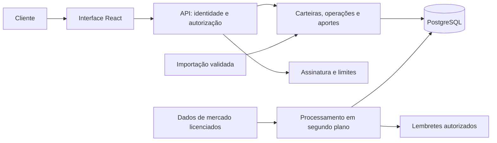

# CryptoDash — viabilidade comercial e plano de evolução para SaaS

**Data da análise:** 23/09/2026. **Código analisado:** commit `7edd640`.
**Status:** proposta para validação; não representa demanda ou receita comprovadas.
**Premissas:** lançamento no Brasil, fundador desenvolvedor, operação enxuta e produto informacional sem custódia nem execução de ordens. Essas premissas devem ser revistas se a estratégia desejada for outra.

## 1. Decisão recomendada

**Existe possibilidade de transformar o projeto em um micro-SaaS, mas a viabilidade comercial ainda precisa ser demonstrada.** O projeto tem componentes úteis e uma base de testes relevante. Falta construir a operação para vários clientes e, principalmente, provar que um público específico pagará por um problema que as alternativas atuais resolvem mal.

A tese mais próxima do código existente é **controle confiável de carteira e rotina de aportes para brasileiros que compram cripto regularmente em mais de uma plataforma**. O resultado vendido seria: consolidar operações reais, explicar diferenças de saldo, acompanhar metas definidas pelo próprio usuário e entregar um histórico organizado em reais.

Dashboard, gráficos, notícias e IA ajudam a experiência, mas isoladamente sustentam pouco a diferenciação. Minha recomendação é investir primeiro em duas semanas de descoberta e só liberar o orçamento de construção depois de obter compromissos concretos de uso e pagamento.

| Dimensão | Avaliação desta análise | Consequência |
|---|---|---|
| Reaproveitamento técnico | Favorável para carteira manual e planejamento de aportes | Evoluir o projeto existente |
| Prontidão para vários clientes | Insuficiente | Isolamento e autorização são bloqueadores |
| Diferenciação atual | Fraca diante de produtos gratuitos e pagos | Escolher uma tarefa específica e mensurável |
| Demanda pelo recorte proposto | Não validada | Entrevistar, testar importações reais e cobrar um piloto |
| Potencial de negócio enxuto | Plausível, condicionado a retenção e aquisição barata | Buscar dezenas de pagantes antes de ampliar escopo |
| Potencial de negócio de grande escala | Sem evidência suficiente | Não extrapolar adoção de cripto para receita de software |

Não atribuo um percentual de “pronto para SaaS”: parte importante do trabalho ainda é descoberta de produto, confiabilidade operacional e aquisição de clientes.

## 2. O que foi verificado no projeto

Foram lidos domínio, serviços, autenticação, persistência, jobs, componentes da interface, configuração de produção, documentação e testes. A imagem do dashboard em `docs/screenshots/03-dashboard-completo.png` foi inspecionada como registro histórico da interface, não como comprovação de uma aplicação em produção.

**Validação local realizada:** 113 testes .NET aprovados, 18 testes de frontend aprovados e build de produção do frontend concluído. O build aponta um pacote JavaScript de aproximadamente 696 kB antes da compressão; vale otimizar depois dos bloqueadores de produto. As primeiras tentativas tiveram limitações de execução do ambiente; a validação foi concluída em novas execuções.

Isso não comprova isolamento entre clientes, concorrência real em PostgreSQL, integrações ao vivo, capacidade de produção nem recuperação de desastre. A suíte usa SQLite em memória; suas limitações estão no [TestDb](../../tests/CryptoDash.Application.Tests/TestDb.cs). Os placares dos READMEs de testes e specs estão desatualizados em relação à execução atual.

### Base que vale preservar

- Carteira em BRL, registro manual de compras/vendas, posições e metas de alocação.
- Recalculo centralizado de custo e quantidade; armazenamento do custo total com maior precisão.
- Planejamento de aportes e distribuição determinística com fechamento dos centavos.
- Transações de banco, tratamento de concorrência e proteção contra duplicação de aportes.
- Reconciliação do histórico interno com as posições calculadas.
- Atualização compartilhada de mercado, indicadores, notícias e resumo com fallback.
- Separação em projetos .NET, frontend React/TypeScript, migrations e implantação em contêineres.
- Validações de segredos, limitação de login, verificação de preços, readiness e backup local verificado.

### Lacunas com impacto comercial

| Prioridade | Evidência no código | Impacto e evolução necessária |
|---|---|---|
| P0 | [Transaction](../../src/CryptoDash.Domain/Entities/Transaction.cs), [Holding](../../src/CryptoDash.Domain/Entities/Holding.cs) e [AportPlan](../../src/CryptoDash.Domain/Entities/AportPlan.cs) não têm proprietário; [PortfolioService](../../src/CryptoDash.Application/Services/PortfolioService.cs) consulta dados globais | Criar uma segunda credencial não cria uma carteira isolada. Implementar conta, carteira, autorização e testes entre clientes antes de receber dados de terceiros |
| P0 | [AppDbContext](../../src/CryptoDash.Infrastructure/Persistence/AppDbContext.cs) usa índices únicos por moeda para posição/meta e chave de idempotência global | A migração envolve relacionamentos, índices, consultas, jobs e idempotência; não basta adicionar um campo `UserId` |
| P0 | [AportsService](../../src/CryptoDash.Application/Services/AportsService.cs), em `ExecuteAsync`, deriva quantidade do preço de mercado e grava taxa zero | Separar simulação de comprovante. Confirmação precisa de quantidade, preço e taxa efetivamente negociados; os registros atuais devem preservar indicação de estimativa quando aplicável |
| P0 | [PortfolioService](../../src/CryptoDash.Application/Services/PortfolioService.cs) calcula P&L com o custo das posições restantes; variação de 24h usa as quantidades atuais | “P&L total” não é o resultado histórico completo, incluindo vendas. Exibir resultado não realizado com nome correto; desenvolver resultado realizado e retorno ajustado a fluxos com metodologia explícita |
| P0 | [TransactionType](../../src/CryptoDash.Domain/Enums/TransactionType.cs) contém apenas compra e venda | Não representa adequadamente transferência entre contas, recebimento, taxa em cripto e troca cripto/cripto. Definir suporte e bloquear importações não suportadas sem transformá-las em compras fictícias |
| P0 | [AuthController](../../src/CryptoDash.Api/Controllers/AuthController.cs) só tem login; [authStore](../../frontend/src/stores/authStore.ts) persiste token; produção configura validade de sete dias | Faltam cadastro ou convite, recuperação, verificação de e-mail, revogação e administração de sessão. Projetar sessão segura e proteção contra abuso |
| P1 | [DbSeeder](../../src/CryptoDash.Infrastructure/Persistence/DbSeeder.cs) cria 11 moedas, metas pessoais e aporte de R$ 300 | Novo cliente deve escolher seus próprios ativos/metas; retirar alocação pessoal da criação de contas. Manter catálogo revisável e identificação de ativos além do ticker |
| P1 | Não foram localizados importadores, assinaturas, cobrança, exportação do usuário ou gestão de planos | O cliente depende de digitação e o negócio não tem ciclo de aquisição, ativação, cobrança e cancelamento |
| P1 | [AportReminderJob](../../src/CryptoDash.Infrastructure/Jobs/AportReminderJob.cs) apenas escreve log | Lembrete não chega ao usuário. Implementar entrega com consentimento, preferências, fuso e prevenção de duplicatas |
| P1 | [PortfolioService](../../src/CryptoDash.Application/Services/PortfolioService.cs) materializa transações antes de paginar; [DependencyInjection](../../src/CryptoDash.Infrastructure/DependencyInjection.cs) agenda jobs dentro da API | Paginar no PostgreSQL; controlar execução única dos jobs antes de replicar a API. Não multiplicar coleta de cotações pelo número de clientes |
| P1 | [docker-compose.prod.yml](../../docker-compose.prod.yml) grava backups no mesmo host; não há pipeline `.github` no checkout | Criar cópia externa criptografada, restauração ensaiada, CI, staging e procedimento de migração/rollback. Não foi auditado eventual pipeline externo |
| P2 | [App.tsx](../../frontend/src/App.tsx) oferece login/carteira; o modal cita Itaú íon e “transaction”; digest apresenta Markdown em texto | Construir onboarding, configurações e histórico navegável; explicar termos em português e apresentar fontes/estados dos dados de forma compreensível |

Há uma diferença importante entre **reconciliar duas representações no mesmo banco**, que já existe, e **conferir a carteira contra o extrato da corretora**, que seria parte do valor comercial proposto.

Também é necessário planejar a atualização do runtime: o suporte ao .NET 8 termina em **10/11/2026**. A migração para .NET 10 LTS deve entrar antes do lançamento comercial, com compatibilidade de EF Core/Npgsql e regressão verificada. [Política oficial da Microsoft](https://dotnet.microsoft.com/en-us/platform/support/policy).

## 3. Mercado: há atividade, mas isso não comprova disposição para pagar

O Brasil ficou em **5º lugar no índice de adoção de cripto de 2025 da Chainalysis**. O índice combina medidas de atividade e não equivale ao número de potenciais compradores de uma assinatura. [Pesquisa original da Chainalysis](https://www.chainalysis.com/blog/2025-global-crypto-adoption-index/).

A Receita Federal informa que stablecoins representaram aproximadamente **80% do volume declarado em 2025**. Isso limita a interpretação de que todo o crescimento do mercado favorece um dashboard de investimento: parte relevante da atividade pode atender pagamentos, câmbio e outras finalidades. Essa última conclusão é uma inferência de produto, não uma segmentação publicada dos compradores de SaaS. [Receita Federal, julho de 2026](https://www.gov.br/receitafederal/pt-br/assuntos/noticias/2026/julho/stablecoins-ja-respondem-por-cerca-de-80-do-volume-declarado-de-criptoativos-no-brasil).

A mudança para DeCripto reforça a relevância de histórico e organização de dados. Ela não demonstra que nosso público queira contratar um novo produto, nem transforma um controle de carteira em solução fiscal pronta. [Atos oficiais da DeCripto](https://www.gov.br/receitafederal/pt-br/assuntos/orientacao-tributaria/declaracoes-e-demonstrativos/criptoativos/decripto).

### Concorrentes e substitutos

Preços consultados em 23/09/2026, nas páginas públicas dos fornecedores. Funcionalidades são ofertas declaradas pelos próprios fornecedores, sem teste comparativo de precisão. Preço mensal, anual parcelado e cobrança por ano fiscal não são equivalentes.

| Alternativa | Oferta observada e preço de referência | O que significa para o CryptoDash |
|---|---|---|
| [CoinMarketCap Portfolio](https://coinmarketcap.com/events/portfolio/) | Acompanhamento de carteira gratuito | Visualização básica tem substituto com preço zero |
| [CoinStats](https://coinstats.app/pricing/) | Plano gratuito; anúncio de Premium a US$ 13,99/mês; análise, alertas e recursos de IA | IA e visão consolidada já estão na oferta concorrente. A página tem limites divergentes entre tabela e FAQ; não usar esses limites como benchmark fechado |
| [Delta](https://delta.app/academy/post/introducing-delta-pro-pro-more-power-more-choice) | Básico gratuito; PRO anunciado a US$ 6,99 mensal ou desde US$ 4,49/mês no anual; preço varia por mercado/loja | Disputa forte por acompanhamento e explicação do portfólio |
| [Koinly](https://koinly.io/pricing/) | Uso gratuito para acompanhamento; relatórios a partir de US$ 49 por ano fiscal, até 100 transações nesse plano | Organização e documentos monetizam uma tarefa concreta; não confundir presença internacional com cobertura completa das obrigações brasileiras |
| [myProfit](https://lp.myprofitweb.com/) | PRO anunciado em 12 parcelas de R$ 29,90, com Brasil, exterior e cripto | Concorrente local relevante com proposta fiscal. R$ 358,80 no conjunto das 12 parcelas; não tratar como assinatura mensal avulsa |
| Planilhas e aplicativos das próprias corretoras | Substitutos que já fazem parte da rotina do usuário | O produto precisa economizar trabalho suficiente para justificar migração e assinatura |

**Conclusão da comparação:** português, BRL, notícias e IA são insuficientes como promessa exclusiva. A hipótese de diferenciação é uma experiência melhor para um conjunto delimitado de operações e fontes, com conferência compreensível, procedência de cada lançamento e rotina de aportes. Precisamos demonstrar essa vantagem em tarefas reais contra as alternativas acima.

## 4. Qual recorte escolher

As avaliações abaixo são julgamentos desta análise, não resultados de entrevistas.

| Recorte | Proximidade do código | Potencial de cobrança | Esforço/risco | Decisão sugerida |
|---|---|---|---|---|
| Dashboard genérico com IA | Alta | Baixo | Concorrência e aquisição difíceis | Manter como componente |
| Carteira conferível + rotina de aportes no Brasil | Alta/média | Médio, a validar | Importação e confiança nos cálculos | **Primeiro experimento** |
| Organização de documentos para contadores | Média | Possivelmente maior por conta | Permissões e fluxo profissional | Entrevistar como segunda hipótese |
| Motor fiscal completo com DeCripto/IR | Baixa | Problema concreto, já disputado | Alto custo de regras, atualização e responsabilidade | Só com demanda paga e parceiro especialista |
| Tesouraria empresarial em stablecoins | Baixa | Pode ter maior ticket | Exige outro domínio e operação | Avaliar como produto separado |
| Bots, copy trading e execução de ordens | Baixa | Mercado existente | Segurança, responsabilidade e regulação elevadas | Fora do plano inicial |

### Público inicial proposto

Brasileiro que compra cripto ao menos mensalmente, usa duas ou mais fontes ou mantém autocustódia, tem histórico que já demanda conferência e consegue mostrar a dificuldade atual. Para recrutar, testar inicialmente carteiras de R$ 20 mil a R$ 300 mil e 3–15 ativos; essas faixas são filtros experimentais, não dados de mercado nem critérios definitivos de contratação.

Quem compra um único ativo em uma única plataforma pode ter pouca necessidade do produto. Traders intensivos e usuários de DeFi complexo exigem mais integrações e regras que o MVP comporta.

**Proposta de valor a testar:** “Confira sua carteira cripto em reais, acompanhe seus aportes e organize o histórico para compartilhar com seu contador.”

O primeiro fluxo de valor deve caber em uma sessão: importar um extrato suportado → revisar pendências → conferir saldo → definir meta própria de aporte → visualizar progresso → exportar histórico com origem dos registros. A promessa de tempo só deve ser publicada depois de medida.

## 5. Escopo do produto inicial

**Obrigatório antes de receber dados de clientes:** isolamento por conta/carteira, autenticação adequada, autorização em todas as operações, segurança de uploads, exclusão/exportação, backup externo com restauração verificada e termos/privacidade revisados para o serviço real.

**Obrigatório para o piloto comercial:**

- Um portfólio por conta na interface, com estrutura preparada para separar contas de origem.
- Lançamento manual completo e importação CSV de um formato comprovado no primeiro corte; segundo formato conforme demanda.
- Prévia, validação por linha, prevenção de duplicatas, relatório de erros e desfazer importação.
- Quantidades/preços/taxas reais, origem e data de cada evento; estimativas visualmente identificadas.
- Compra, venda, transferência própria e taxas dentro de uma matriz de suporte explícita. Operações desconhecidas ficam pendentes.
- Posição e custo por ativo, conferência contra extrato e exportação CSV legível por contador.
- Metas e plano de aportes definidos pelo usuário, simulação separada do registro de execução, lembrete opt-in e revisão mensal.
- Cobrança em reais, cancelamento simples, limites claros, canal de suporte e medição de ativação/renovação.

**Depois de verificar retenção:** uma integração de exchange apenas de leitura, mais formatos CSV, snapshots de patrimônio, resultado realizado, métricas de retorno bem definidas e relatórios compartilháveis com acesso revogável.

**Fora do primeiro produto:** custódia, chaves privadas, ordens automáticas, recomendação personalizada de ativos, promessa de rentabilidade, cálculo ou envio automático de obrigação fiscal, suporte irrestrito a DeFi/NFT/derivativos, aplicativo nativo, white-label e dezenas de exchanges.

A escolha dos importadores depende dos extratos dos participantes. Binance spot e uma exchange brasileira são candidatas, não integrações prometidas. A referência atual ao Itaú íon não comprova disponibilidade de API de integração; não basear a estratégia nisso sem validar acesso e termos.

## 6. Arquitetura de evolução

Preservar o monólito e a stack .NET/React/PostgreSQL, atualizando versões suportadas. Para esse estágio, o principal problema arquitetural é a fronteira entre dados públicos e dados do cliente.

| Área | Desenho inicial |
|---|---|
| Identidade | `User` e `Account`; uma conta pessoal por usuário inicialmente. Cadastro/convite e recuperação pelo fluxo escolhido de identidade |
| Carteira | `Portfolio`, `SourceAccount`, operações, posições, metas e aportes vinculados à conta; conta obtida da identidade autenticada |
| Isolamento | Validação explícita de propriedade, filtros centralizados, índices e FKs compostos quando necessários. Testes com dois clientes em toda leitura/escrita, exportação, jobs e cache |
| Mercado | Catálogo, preços e notícias compartilhados. Identificador de fornecedor; rede/contrato quando pertinente. Ticker não é identificador universal |
| Importação | `ImportBatch`, registros originais protegidos, normalização, estado de revisão, chave externa e deduplicação por conta/fonte. Retenção de arquivos definida |
| Razão | Eventos comprovados preservam origem; correções auditáveis. Posições são projeções recalculáveis. Não é necessário adotar uma plataforma de event sourcing |
| Assinatura | Um provedor, checkout hospedado, eventos idempotentes, estados de assinatura e limites no servidor |
| Jobs | Coleta compartilhada; filas/estado de execução persistente onde necessário; apenas um executor ou coordenação explícita ao escalar |
| IA | Resumo compartilhado de fatos públicos, fontes e orçamento mensurável. Não enviar posições, identificadores ou extratos por padrão |
| Operação | Staging, CI, segredos fora do repositório, observabilidade, backup fora do host e restauração ensaiada |

A migração deve atribuir explicitamente os dados existentes à conta do proprietário, mudar unicidades globais, rever o vínculo 1:1 entre moeda e posição/meta e verificar o saldo antes/depois. Query filters isoladamente não garantem segurança. Rotinas administrativas e jobs precisam de escopo explícito.

O uso atual de `IAppDbContext`/`DbSet` nos serviços é uma escolha do projeto. Não recomendo transformar toda a persistência em repositories genéricos apenas por padronização; concentrar a mudança em autorização, consistência e limites de responsabilidade. Também não há justificativa atual para microserviços, Kubernetes ou um cache distribuído obrigatório.

## 7. Licenças, privacidade e fronteira regulatória

Estes pontos afetam o desenho e o custo do produto; o enquadramento jurídico final depende do serviço efetivamente oferecido.

- **Dados de mercado:** a CoinGecko publica Basic a US$ 35/mês ou US$ 348/ano, antes de impostos. Sua documentação inclui licença comercial no Basic e exige atribuição; redistribuir dados brutos e remover atribuição pode exigir outro contrato. A página também descreve Basic como uso pessoal, então confirmar por escrito o caso concreto e os endpoints antes de contratar. [Preços](https://www.coingecko.com/en/api/pricing) e [licença comercial](https://support.coingecko.com/hc/en-us/articles/16760512207257-What-Are-the-Differences-Between-Commercial-and-Custom-Licenses).
- **Integração da API paga:** o cliente atual não configura o header de chave CoinGecko. Prever chave no servidor, base URL correta, cotas e medição. [Instrução oficial de autenticação](https://support.coingecko.com/hc/en-us/articles/9383547636249-Quick-Start-on-using-CoinGecko-Pro-API).
- **Notícias e outros dados:** confirmar condições comerciais, cache, atribuição e uso de títulos em resumos. Não foi possível confirmar os termos comerciais atuais da CryptoPanic na [página pública consultada](https://cryptopanic.com/developers/api/). Notícias podem ficar fora do piloto caso a licença não esteja resolvida. Confirmar também condições da Alternative.me e permissões das exchanges.
- **Privacidade:** mapear dados coletados e fornecedores, minimizar retenção, permitir acesso/exportação/exclusão conforme as obrigações aplicáveis, proteger uploads e manter resposta a incidentes. Patrimônio e histórico associado a uma pessoa não devem ser tratados como irrelevantes à privacidade. [Guia de segurança da ANPD para pequenos agentes](https://www.gov.br/anpd/pt-br/centrais-de-conteudo/materiais-educativos-e-publicacoes/processo-guia-orientativo-sobre-seguranca-da-informacao-para-agentes-de-tratamento-de-pequeno-porte.pdf).
- **Ativos virtuais:** o Banco Central publicou as Resoluções 519, 520 e 521, com entrada em vigor em fevereiro de 2026. A proposta é restringir o serviço a informação e organização, sem movimentar ativos. Isso reduz a superfície operacional, mas não permite declarar dispensa regulatória automática. [Explicação do Banco Central](https://www.bcb.gov.br/detalhenoticia/20930/noticia).
- **Conteúdo e recomendações:** a CVM trata dos criptoativos que sejam valores mobiliários no Parecer 40. Submeter o catálogo, textos, simulações e possíveis recomendações a revisão jurídica. Um aviso genérico não substitui avaliar a atividade. As metas pessoais hoje seedadas devem sair do onboarding. [Parecer oficial da CVM](https://conteudo.cvm.gov.br/export/sites/cvm/legislacao/pareceres-orientacao/anexos/Pare040.pdf).
- **Fiscal:** DeCripto, declaração anual de renda e apuração de imposto são entregas distintas. Exportar um histórico não equivale a cumprir todas elas. Um módulo fiscal precisa de escopo tributário validado por especialista, regras versionadas, casos de referência e acompanhamento de alterações. [Receita Federal — DeCripto](https://www.gov.br/receitafederal/pt-br/assuntos/orientacao-tributaria/declaracoes-e-demonstrativos/criptoativos/decripto).

## 8. Monetização e economia do produto

### Preço como experimento

Começar com **um único plano pago**, teste assistido e amostra demonstrativa. Testar ofertas de **R$ 29, R$ 39 e R$ 49 por mês**, mantendo escopo comparável e registrando objeções. R$ 39 é a referência do modelo abaixo, não o preço validado.

Evitar freemium amplo antes de conhecer custo de suporte e ativação. Limitar número de importações, volume de linhas, contas conectadas e recursos de IA de forma compreensível. Exportação dos próprios dados não deve depender de upgrade. Desconto anual só depois de provar uso por mais de um ciclo mensal; recebimento anual antecipado não é receita mensal recorrente integral.

O concorrente local em 12x de R$ 29,90 pressiona o preço. Para cobrar R$ 39–49, o público precisa perceber uma vantagem específica, como menos retrabalho de conciliação nos extratos suportados. Se comprar apenas por preço, a tese está fraca.

Um plano para contadores de R$ 149–299/mês pode ser explorado futuramente com franquia de clientes, mas essa faixa é hipótese sem validação. Não construir permissões profissionais/white-label antes de compromissos pagos desse segmento.

### Cenário ilustrativo, sem previsão de vendas

Premissas mensais: preço médio efetivamente recebido de R$ 39; provisão conjunta de 10% da receita para tributos e pagamento; R$ 3 por assinante para custos variáveis; R$ 1.200 de custos fixos. Os 10% são hipótese de cálculo, não alíquota tributária nem cotação de gateway.

Orçamento fixo inicial de trabalho: R$ 450 para aplicação/banco/backups, R$ 250 para dados de mercado, R$ 200 para operação/ferramentas e R$ 300 de reserva. São valores para validar com fornecedores, não preços pesquisados de infraestrutura. Para comparar a API em dólares, o orçamento admite câmbio de planejamento de R$ 5,50/US$, não cotação atual; licença e endpoints podem exigir um plano mais caro. Notícias comerciais, integrações adicionais e especialistas ficam fora desse orçamento.

Contribuição por assinante: `39 − 3,90 − 3 = R$ 32,10`.

| Pagantes | Receita recorrente mensal bruta | Contribuição após os custos variáveis | Saldo após R$ 1.200 fixos |
|---:|---:|---:|---:|
| 10 | R$ 390 | R$ 321 | −R$ 879 |
| 50 | R$ 1.950 | R$ 1.605 | R$ 405 |
| 100 | R$ 3.900 | R$ 3.210 | R$ 2.010 |
| 300 | R$ 11.700 | R$ 9.630 | R$ 8.430 |
| 500 | R$ 19.500 | R$ 16.050 | R$ 14.850 |

O saldo não remunera desenvolvimento, aquisição, suporte do fundador nem assessoria jurídica/contábil. O ponto de equilíbrio direto seria 38 pagantes. Ao incluir R$ 3.000/mês de trabalho do fundador, seriam 131 pagantes. Se custos fixos chegarem a R$ 3.000, seriam 94 pagantes antes da remuneração. São contas sobre as premissas, não garantia de margem ou capacidade nessa escala.

Para recuperar aquisição em três meses, o custo por pagante deveria ficar próximo ou abaixo de R$ 96 nesse cenário, considerando também horas comerciais e comissões. Antes de escalar anúncios, medir esse custo e cancelamentos. Com 10% de cancelamento mensal, 100 pagantes exigiriam aproximadamente dez reposições por mês apenas para manter o tamanho da base.

## 9. Validação comercial antes de ampliar desenvolvimento

### Primeiro ciclo: duas semanas

1. Fazer 15 entrevistas com investidores do perfil e cinco com contadores que já atendam cripto. Esses são objetivos de recrutamento; nenhuma entrevista foi realizada nesta análise.
2. Pedir que mostrem a última tarefa de conferência, ferramenta usada, tempo gasto, erros e solução atual. Perguntar por comportamento passado antes de apresentar o produto.
3. Obter cinco conjuntos de extratos anonimizados ou consentidos, com retenção controlada; mapear operações realmente presentes.
4. Testar duas mensagens: “carteira conferida e aportes” e “histórico organizado para o contador”. Avaliar qual tarefa leva a compromisso concreto.
5. Demonstrar o projeto com dados fictícios e apresentar uma oferta de piloto com preço, cobertura e limitações claros.

**Portão para financiar construção:** pelo menos cinco participantes com dor recorrente demonstrada e compromisso explícito com piloto pago na faixa proposta; pelo menos cinco arquivos viáveis; uma fonte que concentre demanda suficiente para o primeiro importador. Interesse verbal isolado não basta. Pagamento efetivo, quando o piloto seguro estiver disponível, será evidência mais forte que intenção.

### Piloto: dez clientes e dois ciclos mensais

- Definir ativação como: importar/registrar dados, resolver ou reconhecer pendências e conferir a primeira posição. Criar conta não é ativar.
- Objetivo inicial: pelo menos 7 de 10 concluírem a ativação; medir mediana de tempo até primeira carteira conferida e a assistência necessária.
- Usar 15 minutos como hipótese inicial de tempo para um extrato suportado, excluindo coleta do arquivo; não publicar promessa antes do teste.
- Observar pagamento e renovação real: objetivo inicial de ao menos 6 de 10 renovarem e utilizarem o fluxo mensal no segundo ciclo.
- Medir minutos de suporte por cliente; buscar no máximo 15 minutos/mês após onboarding. Classificar bugs, dúvidas e casos não suportados.
- Não avançar com vazamento entre clientes ou divergência monetária sem explicação. Esse é requisito de funcionamento, não métrica comercial negociável.

Esses números são portões internos de decisão para uma amostra pequena. Não demonstram product-market fit nem permitem estimar retenção populacional com precisão.

### Aquisição inicial

Recrutamento por rede existente, comunidades com autorização dos moderadores e contadores parceiros. Produzir material prático sobre tarefas que o produto já resolve: conferir extrato, identificar transferência duplicada, entender custo e acompanhar aportes. Medir origem do lead, ativação, pagamento e renovação por canal.

Parcerias com criadores podem ser testadas por comissão sobre clientes efetivamente pagos, sem contratos caros antecipados. Não há envio de mensagens, campanha ou parceria executada como parte desta análise.

**Pivotar para organização profissional** se os contadores demonstrarem demanda paga mais forte e o investidor não renovar. **Interromper ou manter como projeto pessoal** se a dor for rara, as ferramentas gratuitas forem suficientes ou a coleta de dados exigir trabalho manual que inviabilize o ticket. Não responder à falta de pagamento adicionando indicadores e IA indefinidamente.

## 10. Roadmap, esforço e sequência de decisão

As estimativas são faixas preliminares de trabalho focado, não compromisso de entrega. Consideram reaproveitamento do projeto, provedor de identidade/pagamento escolhido, no máximo dois formatos CSV e sem motor fiscal ou conector automático de exchange.

| Etapa | Entrega | Estimativa | Critério para avançar |
|---|---|---:|---|
| F0 — descoberta | Entrevistas, amostras, comparação por tarefa e oferta do piloto | 24–40 h | Cinco compromissos e fonte de dados viável |
| F1 — contas e isolamento | Modelo por cliente, migração, identidade, sessões e testes cruzados | 64–96 h | Dois clientes isolados em leitura/escrita/jobs/exportação; legado preservado |
| F2 — fatos financeiros | Simulação separada de compra real, taxas, transferências, pendências e nomes corretos das métricas | 40–64 h | Casos de referência conciliados e histórico rastreável |
| F3 — ativação | Primeiro CSV completo, segundo conforme amostras, prévia, erros, desfazer, exportação e onboarding | 56–88 h | Usuário consegue conferir carteira em fluxo observado |
| F4 — operação comercial | Cobrança, cancelamento, privacidade, atualização .NET, CI/staging e restauração externa | 56–88 h | Pagamento real controlado e operação recuperável; requisitos jurídicos/licenças resolvidos |
| F5 — retenção | Lembretes, revisão mensal, instrumentação e correções do piloto | 24–40 h | Pagamento e uso em dois ciclos, suporte sustentável |
| **Total base** | | **264–416 h** | Reestimar após F0 e primeiras amostras |
| **Com reserva de 25%** | | **330–520 h** | Não inclui espera por clientes/fornecedores |

Com **20 horas semanais**, o conjunto representa aproximadamente **17–26 semanas** de trabalho; com 35 horas, aproximadamente 10–15 semanas. Observação de renovação exige tempo de calendário e pode se sobrepor às últimas entregas. Um novo conector, importações antigas inconsistentes ou tributação ampliam substancialmente a estimativa.

F4 lista entregas agrupadas, mas seus requisitos de segurança, backup e privacidade começam junto de F1: devem estar prontos antes da primeira entrada de dados externos. Um piloto assistido pode usar convites e cobrança hospedada com ativação administrada; não precisa esperar por todo o autosserviço.

**Plano para os primeiros 90 dias, assumindo 20 h/semana:** dias 1–14 para validar e decidir; dias 15–45 para isolamento e correção do registro de operações; dias 46–75 para um importador e conferência; dias 76–90 para piloto assistido, se os bloqueadores estiverem concluídos. Dois importadores, autosserviço completo e retenção de 60 dias podem ultrapassar esse período. Não prometer lançamento completo em 90 dias.

Ao atribuir R$ 150/h ao trabalho do fundador apenas como custo de oportunidade, 330–520 horas representam R$ 49.500–78.000. Isso reforça a conveniência de liberar o esforço por etapa após evidência, mesmo que o desembolso financeiro imediato seja menor.

O [backlog de execução](backlog-saas.md) detalha as entregas e critérios de aceite. A próxima decisão é escolher participantes e obter extratos para validar o primeiro fluxo; ainda não há evidência que justifique uma expansão ampla de funcionalidades.
